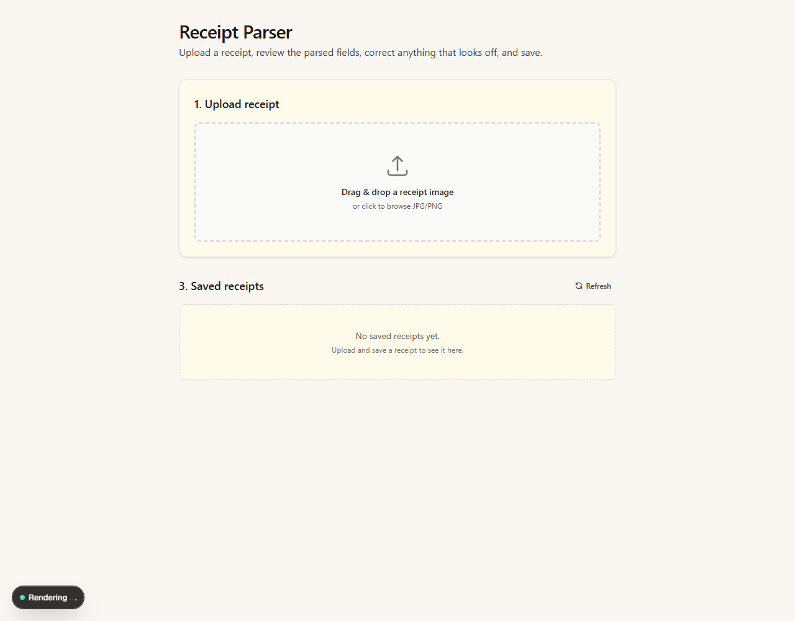
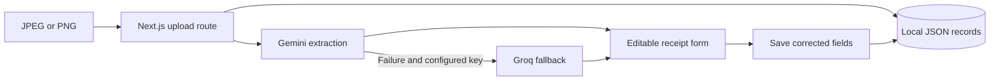

<div align="center">

# Receipt Reader

**From a receipt photo to fields you can review and correct.**

An archived experiment in model-assisted receipt extraction, editable line items and simple local persistence.

[](https://github.com/Muneer320/receipt-reader) [](package.json) [](LICENSE)

[**Run locally**](#run-the-local-demo) · [**Extraction workflow**](#photo-first-review-before-saving) · [**Data limits**](#where-the-data-goes)

</div>

## Photo first, review before saving

Copying merchant names, dates and totals from receipts is repetitive, but extraction can still get them wrong. This demo pairs a model-generated draft with an editable form: inspect line items, correct amounts and check whether the breakdown agrees with the total before saving the record.



*Real application capture from an isolated empty store, with no API keys or personal receipts. It shows the interface before upload; it does not establish live model-extraction quality.*

| Start with an image | Keep review in the loop | Retain a simple record |
| --- | --- | --- |
| JPEG or PNG, up to 5 MB | Editable merchant/date/items/taxes/tip/discount and arithmetic checks | Local JSON records with original images and corrected fields |

> [!IMPORTANT]
> **Archived demo with no authentication.** Anyone who can reach a deployment can access saved receipts and their images. Use synthetic test data locally. Receipt images are sent to the configured model provider for extraction; review its data handling before supplying any private receipt.

## Run the local demo

Use Git, Node.js 20.9+ and a Gemini API key. A Groq key enables the fallback parser. The interface itself can open without credentials; extraction requires a working provider configuration.

```sh
git clone https://github.com/Muneer320/receipt-reader.git
cd receipt-reader
npm ci
```

Copy `.env.example` to `.env.local` (`cp .env.example .env.local` on macOS/Linux or `Copy-Item .env.example .env.local` in PowerShell). Set `GEMINI_API_KEY` and optionally `GROQ_API_KEY`, then:

```sh
npm run dev
```

Open [localhost:3000](http://localhost:3000). Upload a synthetic receipt, review/edit the returned fields and save. `GEMINI_MODEL` and `GROQ_MODEL` select model IDs; provider availability/access and image quality affect parsing. No current live-provider parsing result or accuracy benchmark is claimed.

## The extraction path



<details>
<summary><strong>Implemented routes and arithmetic checks</strong></summary>

- `POST /api/upload` accepts a JPEG or PNG image as a base64 data URL (or raw base64), up to 5 MB. It uses Gemini for structured extraction and tries Groq if Gemini fails and a Groq key is configured.
- `GET /api/receipts` lists saved receipt summaries. `GET /api/receipts/:id` returns a saved receipt. `PUT /api/receipts/:id` saves corrected fields.
- The interface lets you edit merchant, date, line items, subtotal, tax, discount, tip, and total. It flags mismatches between the total and breakdown and between item amounts and subtotal.

</details>

## Where the data goes

The app assumes INR and stores receipt images alongside fields in `src/data/receipts.json`. It has no per-user accounts or private record boundary. Local JSON is suitable for this small demo, not durable multi-user storage.

On Vercel, storage uses `/tmp/receipt-reader`, which is temporary and isolated per function instance. History can disappear or differ between requests. Authentication and durable private storage would be required before handling personal receipts or reviving it as a hosted service.

## Archive and source guide

| Area | Source |
| --- | --- |
| Upload/review interface | [src/app/page.tsx](src/app/page.tsx) |
| Model adapters | [Gemini](src/lib/gemini.ts), [Groq](src/lib/groq.ts) |
| JSON persistence | [src/lib/db.ts](src/lib/db.ts) |
| Environment names | [.env.example](.env.example) |

Run `npm run lint` and `npm run build` to verify the project. The archived source is retained for the upload → extraction → correction workflow and its lessons about model uncertainty and deployment storage. A fork can build on it; include synthetic fixtures and document any new authentication/storage boundaries.

Created by [Muneer Alam](https://github.com/Muneer320). [MIT license](LICENSE).
